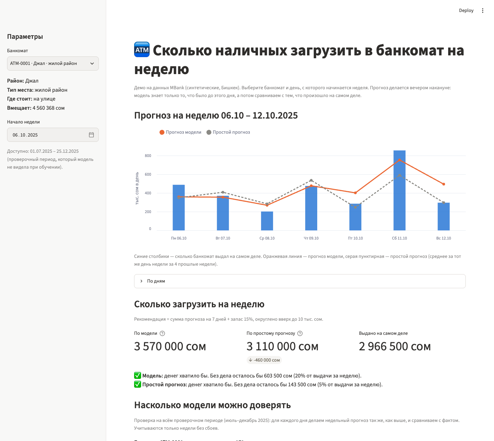

# Прогноз спроса на наличные в банкоматах Бишкека

Учебный проект (Data Science / ML, AI Academy KG).



## Проблема

Банку нужно вовремя загружать банкоматы наличными. Если денег мало, банкомат пустеет, клиенты уходят к конкурентам. Если много, деньги лежат без дела, а каждая лишняя инкассация стоит денег. Сейчас загрузку часто планируют «как в прошлые недели», и это плохо работает в дни пенсий, зарплат и перед праздниками: именно тогда банкоматы и пустеют.

**Цель:** предсказать, сколько наличных выдаст каждый банкомат в ближайшие дни, и на этой основе посоветовать, сколько загрузить на неделю.

## Данные

Датасет [aiacademy-kg/mbank-atm-bishkek](https://huggingface.co/datasets/aiacademy-kg/mbank-atm-bishkek) (CC BY 4.0):

- 120 банкоматов, 2024-01-01 — 2025-12-31 (731 день)
- 12,6 млн транзакций, инкассации, статусы и простои банкоматов
- справочники: банкоматы, районы, клиенты, карты, календарь с праздниками
- внешние факторы: погода (ERA5), курс USD/KGS (НБКР), координаты (OpenStreetMap)

Данные синтетические, но построены на реальном контексте Кыргызстана.

**Качество данных** (`notebooks/03_optimization.ipynb`, раздел 1): дублей и логических ошибок нет, сумма выдачи после агрегации совпадает с транзакциями. Одна операция до даты установки банкомата исключена. Дни, когда банкомат был пуст или не работал (1,3%), не используются как история и оцениваются отдельно: в них видна не потребность клиентов, а то, что банкомат успел выдать. Выбросы — это настоящие пики (пенсии, зарплаты, офисы в выходные), поэтому их не удаляем; проверено, что обрезка ухудшает качество.

## Решение

1. **EDA** (`01_eda.ipynb`): агрегация транзакций до «банкомат × день», флаги сбоев, сезонность, особые дни, погода, курс.
2. **Модели** (`02_models.ipynb`): naive → среднее по дню недели → Ridge → LightGBM. Честное разбиение по времени: обучение до 30.06.2025, проверка на июле–декабре 2025.
3. **Оптимизация** (`03_optimization.ipynb`): качество данных, новые признаки (день месяца, выдача 28 дней назад), подбор параметров Optuna на мае–июне 2025, разбор ошибок.
4. **Демо** (`app.py`): прогноз на 7 дней для любого банкомата и рекомендация по загрузке.

Модель прогнозирует выдачу банкомата на завтра по его истории (вчера, 7, 14, 28 дней назад, средние за 7 и 28 дней), календарю (день недели и месяца, праздники, пенсии, зарплата), типу места, району и погоде. Прогноз на неделю строится по шагам: следующий день опирается на прогнозы предыдущих.

## Результаты

Test: 01.07–31.12.2025, прогноз на следующий день, дни без сбоев. **WAPE** — сумма ошибок / сумма факта (главная метрика: «на сколько процентов ошибаемся в общем объёме денег»).

| Модель | MAE, сом | WAPE | WAPE в дни сбоев |
|---|---:|---:|---:|
| Naive (7 дней назад) | 218 028 | 38,25% | 44,59% |
| Baseline: среднее по дню недели за 4 недели | 168 136 | 29,50% | 36,50% |
| Ridge | 162 104 | 28,4% | 34,3% |
| LightGBM (ноутбук 02) | 133 229 | 23,37% | 26,27% |
| LightGBM + день месяца и лаг 28 | 130 008 | 22,81% | 25,49% |
| **LightGBM + признаки + Optuna (итоговая)** | **129 515** | **22,72%** | **25,24%** |

- Итоговая модель на **23% точнее** baseline и в 1,7 раза точнее naive. Средняя выдача — 570 тыс. сом в день на банкомат.
- Почти всё улучшение над ноутбуком 02 дали **новые признаки** (−0,56 п.п.), Optuna — ещё −0,09 п.п.
- **Для недельной загрузки** (прогноз на 7 дней + запас 15%, вся сеть): ошибка недельной суммы 9,4% против 14,4% у baseline; загрузки хватает на всю неделю в **91%** недель против 85%, при этом без дела остаётся меньше денег (659 тыс. против 758 тыс. сом в среднем).
- Хуже всего модель работает в праздники (мало примеров в истории) и на банкоматах с малым числом клиентов (там больше случайности). По дням недели и месяцам качество ровное.

Ограничения: данные синтетические; скачков курса в проверочном периоде не было; погода в недельном прогнозе берётся фактическая (в жизни это был бы прогноз погоды, но на модель она почти не влияет).

## Как запустить

```bash
git clone https://github.com/iskndrvv/atm-cash-forecast.git
cd atm-cash-forecast
python3 -m venv venv
source venv/bin/activate
pip install -r requirements.txt

# скачать данные (~775 MB)
hf download aiacademy-kg/mbank-atm-bishkek --repo-type dataset --local-dir ./data/mbank-atm-bishkek

# собрать таблицу «банкомат × день» (data/processed/daily.parquet)
jupyter nbconvert --to notebook --execute --inplace notebooks/01_eda.ipynb
```

На macOS для LightGBM нужна библиотека OpenMP: `brew install libomp`. Проект проверен на Python 3.14.

### Демо

```bash
streamlit run app.py
```

Откроется страница в браузере (http://localhost:8501). Слева выберите банкомат (видны район и тип места) и день начала недели в проверочном периоде (июль–декабрь 2025). Приложение покажет:
- прогноз выдачи на 7 дней против факта и против простого прогноза;
- сколько наличных загрузить (прогноз + 15%) по модели и по простому прогнозу, и хватило бы их на самом деле;
- насколько модель точнее простого прогноза — для выбранного банкомата и всей сети.

Для демо нужны `data/processed/daily.parquet` (ноутбук 01) и `models/` (уже в репозитории; пересобирается ноутбуком 03).

## Структура

```
app.py       — Streamlit-демо
src/         — недельный прогноз на сохранённой модели (forecast.py)
models/      — итоговая модель LightGBM и описание признаков (features.json)
notebooks/   — 01 EDA, 02 модели, 03 качество данных и оптимизация
reports/     — графики
data/        — данные (не хранятся в git)
```
